# ShortletsbyShar - System Architecture

## High-Level Architecture Diagram

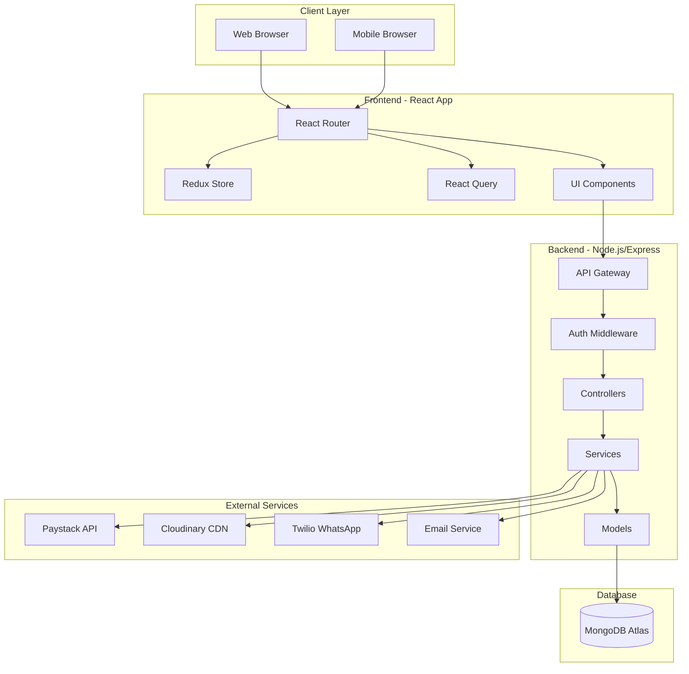

## Detailed Component Flow

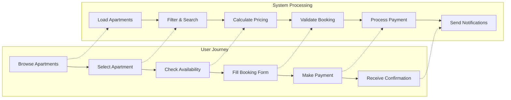

## Database Relationships

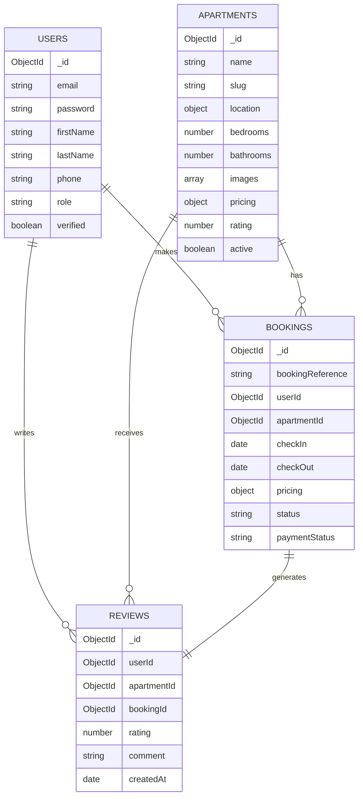

## Booking Flow Sequence

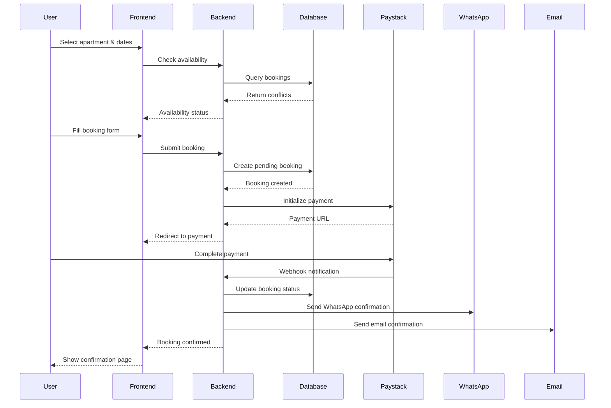

## Admin Panel Architecture

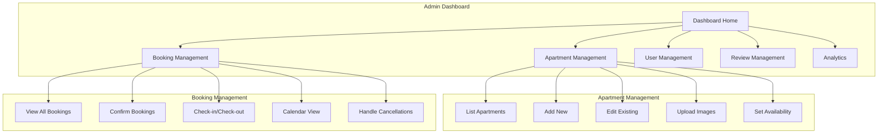

## Payment Processing Flow

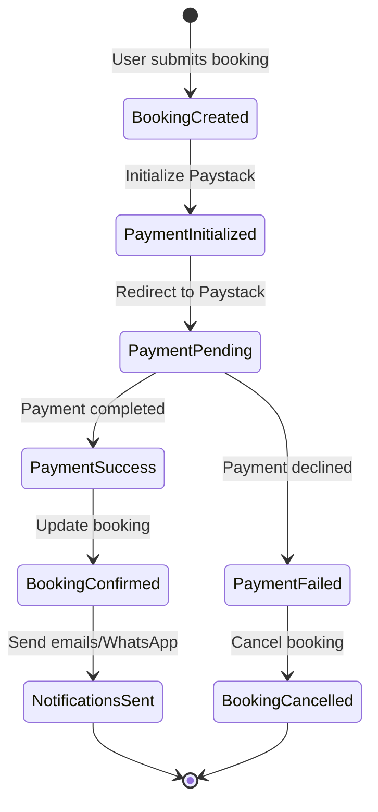

## Authentication Flow

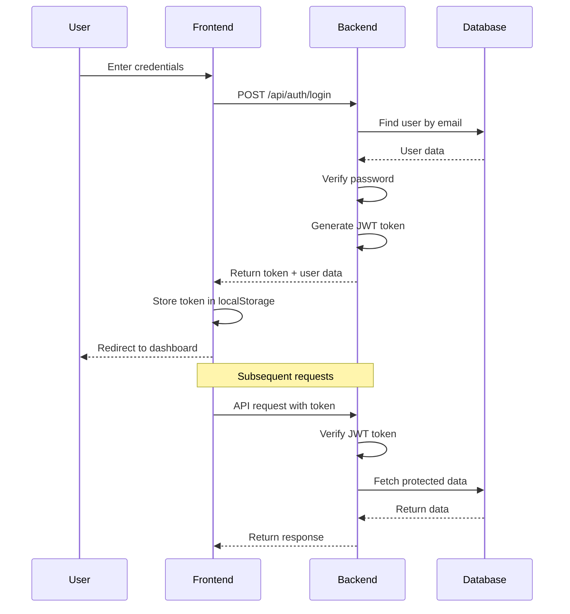

## File Upload Process

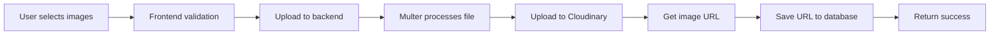

## Search & Filter Architecture

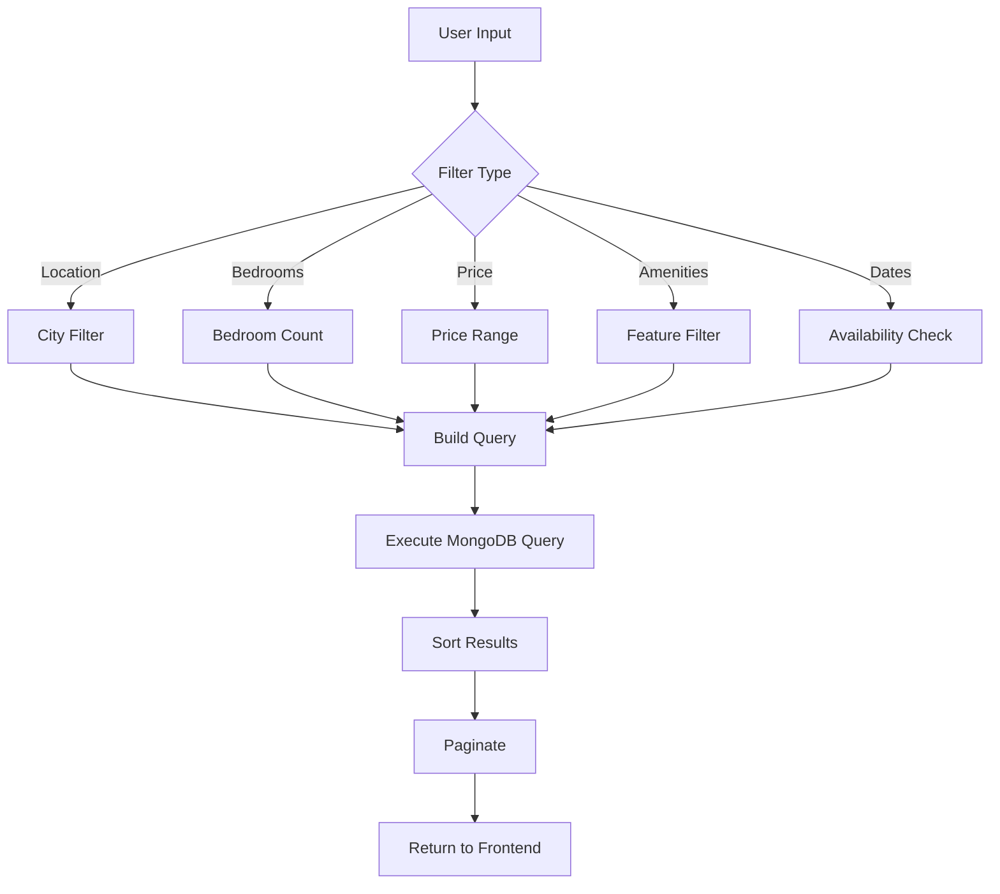

## Notification System

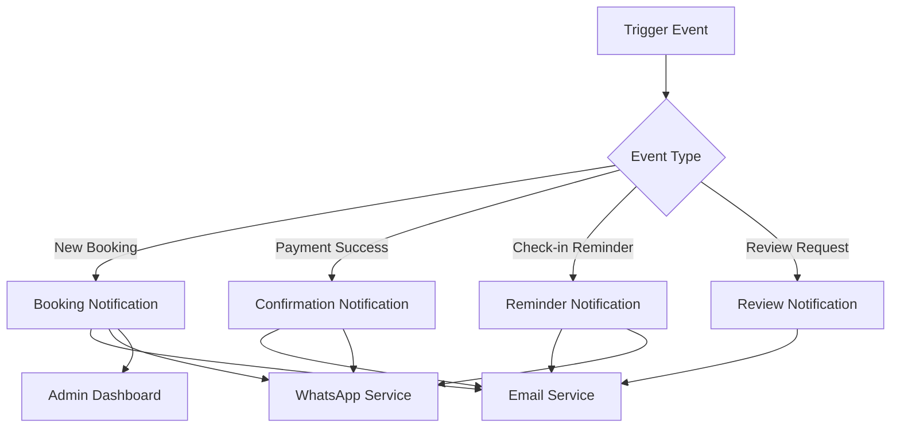

## Deployment Architecture

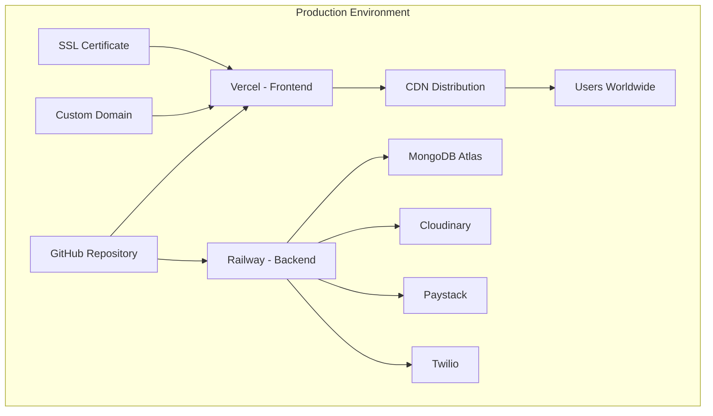

## Security Layers

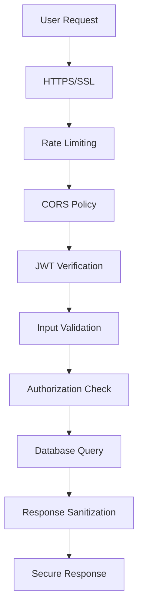

## Mobile Responsive Strategy

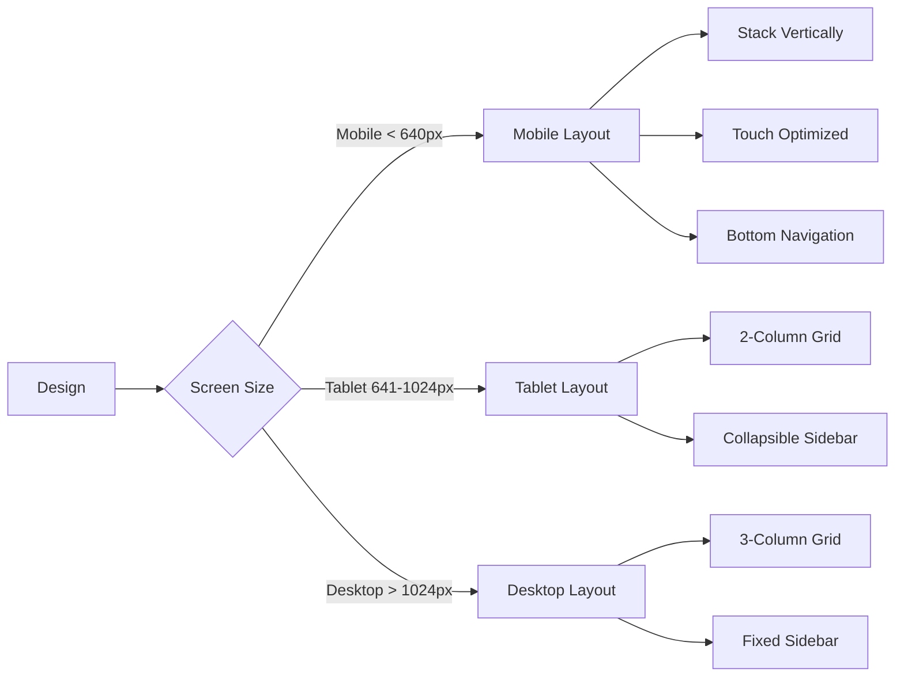

## Caching Strategy

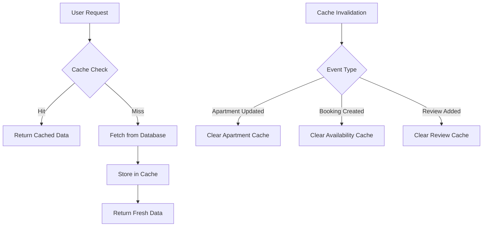

## Error Handling Flow

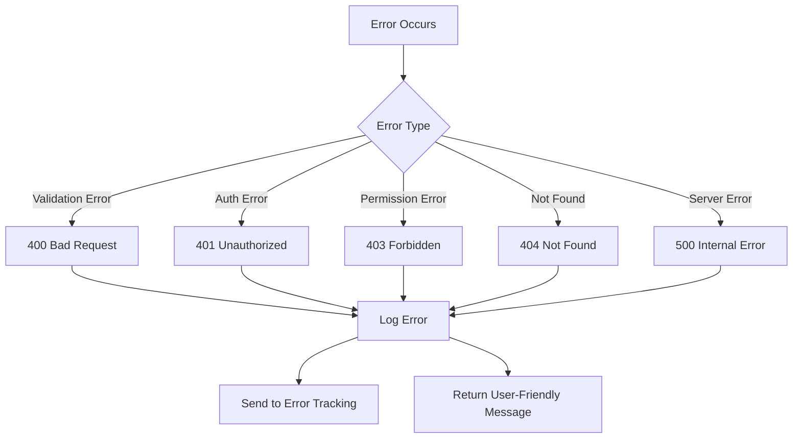

---

## Technology Stack Visualization

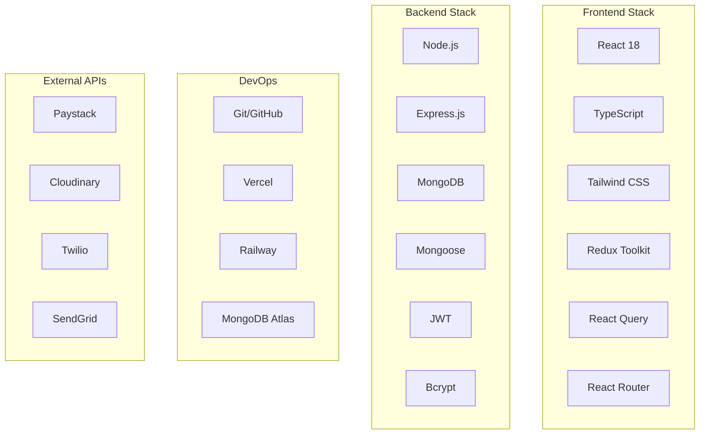

---

These diagrams provide a comprehensive visual overview of the ShortletsbyShar booking platform architecture, showing how all components interact and work together to create a seamless booking experience.